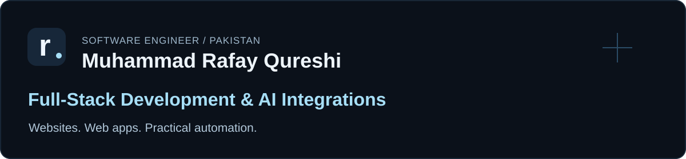

I build business websites, web apps and practical AI integrations. I'm a software engineer based in Pakistan with **4+ years of hands-on project experience**.

### What I can help you build

- **Business websites & online stores** — responsive interfaces, clear journeys, and WordPress or ecommerce work.
- **Web apps & dashboards** — frontend development, APIs, and database-backed workflows.
- **AI integrations & automation** — model APIs, assistants, and useful workflow tools.

**Toolkit:** React · Next.js · Node.js · Python · PostgreSQL · WordPress · JavaScript

### Selected code

| Project | What to explore | Scope |
| --- | --- | --- |
| [Software engineering portfolio](https://github.com/rafayyqureshi/rafay-portfolio) | Real website captures, project details, and interactive demos | Personal portfolio |
| [EmotionSense](https://github.com/rafayyqureshi/EmotionSense) | Flask application for single-comment and CSV emotion-analysis workflows | Existing Python prototype |
| [Aether](https://github.com/rafayyqureshi/aether-writing-studio) | Writing workspace with local templates and tone controls | Original frontend concept |
| [Kanso](https://github.com/rafayyqureshi/kanso-storefront) | Product filters, shopping bag, quantities and totals | Original frontend concept |
| [Pulse](https://github.com/rafayyqureshi/pulse-analytics) | Reporting periods, sample charts and subscription search | Original frontend concept |
| [Haven](https://github.com/rafayyqureshi/haven-property-search) | Budget and neighborhood filters, saved sample homes | Original frontend concept |
| [Flowboard](https://github.com/rafayyqureshi/flowboard-workspace) | Add tasks and move work across a Kanban board | Original frontend concept |

### Selected websites

[Creventa](https://creventa.com/) · [Kokobeo](https://kokobeo.com/) · [BuyCondo.sg](https://buycondo.sg/)

Website previews are included in the portfolio. The live websites may include later work by other contributors; client source code is not republished here.

### Working together

Open to freelance projects and remote opportunities. I focus on clear communication, maintainable code, and software that solves a useful business problem.

